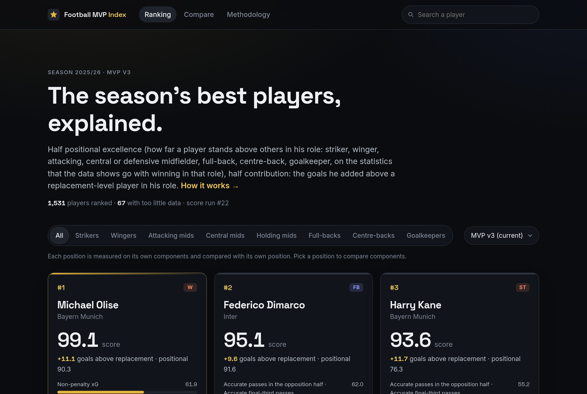
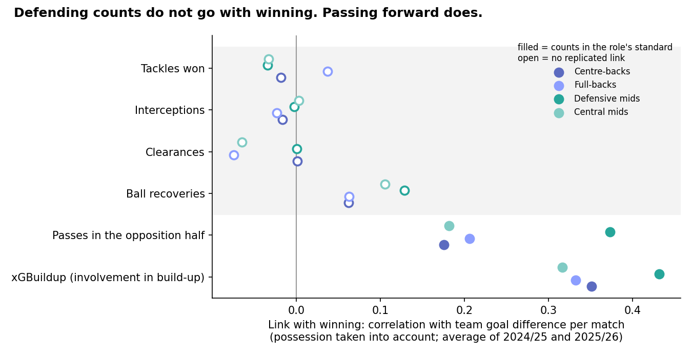
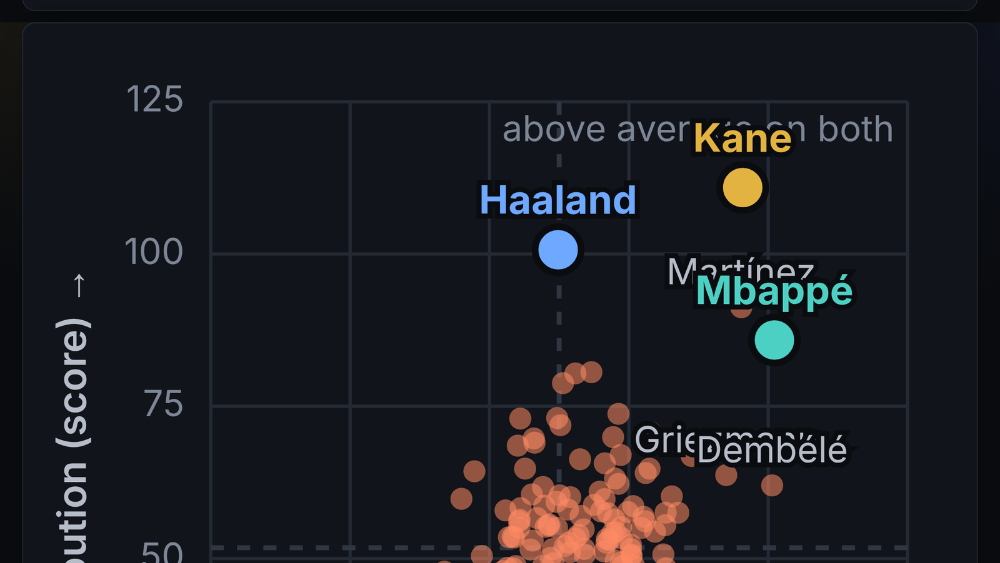
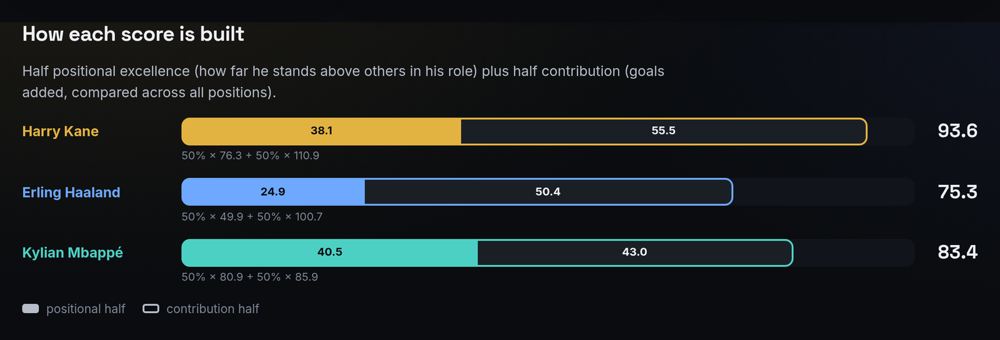
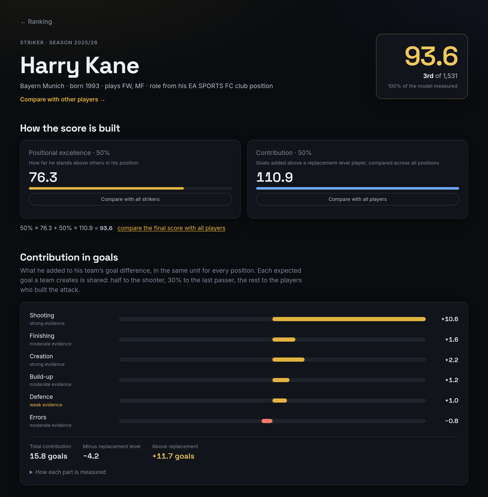
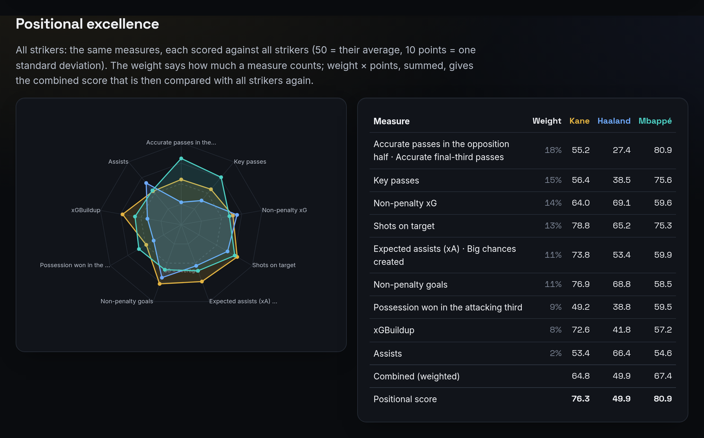

# Football MVP Index

**Who was the best footballer of the 2025/26 season, and can a ranking explain *why*?**

A data-driven Ballon d'Or for the five big European leagues. Every player gets a score that can be
traced step by step to the statistics behind it, and no statistic or weight is picked by hand: the
data decides what counts.

## In short

- **2,691 players**, 5 leagues, 4 data providers, 2 seasons; **1,531 ranked** (the rest played too
  little to judge).
- **The data decides the weights.** For each of 8 roles (striker, winger, … goalkeeper), 58 candidate
  statistics are tested on two seasons: does a player who does more of it play in a team that wins,
  and does it repeat from season to season? Only what passes counts.
- **Three findings stand out:** defensive action counts (tackles, interceptions) do not go with
  winning; Erling Haaland is an *average* striker on everything except scoring; and every score can
  be rebuilt by hand, as Harry Kane's shows below.

## The question

Awards like the Ballon d'Or are decided by votes, and votes favour goals, trophies and reputation.
This project asks a narrower question that data can answer: **over one league season, which players
did the most for their team, compared with others in the same role?** The answer has to be
explainable: for every player, it must be possible to see which numbers produced his score and how.

## The data

| | |
|---|---|
| **Players** | Every player in the Premier League, La Liga, Serie A, Bundesliga and Ligue 1, 2025/26 (and 2024/25 to test which statistics matter) |
| **Statistics** | 78 per player: goals and expected goals (xG), passing, chance creation, duels, tackles, saves, errors, … |
| **Sources** | FBref, Understat and SofaScore statistics and EA SPORTS FC positions, via the public [Top-5 Football Dataset](https://github.com/m-mahadi/top5-football-dataset); Champions League statistics from SofaScore, checked against FotMob |
| **Results** | Every league match with its score, for each team's goal difference |

Most of the work was making the data trustworthy before using it
([how the data was collected and cleaned](docs/data-pipeline.md)):

- **Transfers.** A player who changed clubs has a row per club. Some providers repeat one club's
  numbers on every row, so a naive sum double-counts. Each provider's numbers are checked against
  the official playing time and marked *ok*, *partial* or *suspect*.
- **Wrong merges.** The dataset merged two different players called Vitinha, born in the same
  year. Such cases are detected and split again.
- **Missing is not zero.** A statistic a provider does not have is left out, never counted as 0.
- **Rates on the right minutes.** "Per 90 minutes" uses the minutes of the provider that supplied
  the number.

## The approach

**Score = 50% positional excellence + 50% contribution in goals.**

1. **Role.** Each player is compared only with players in the same role (8 roles), so a centre-back
   is not judged on goals.
2. **Positional excellence: which statistics count is measured, not chosen.** For every role and
   every statistic, two questions are asked of the data:
   - *Does it go with winning?* The correlation between the statistic and the team's goal difference
     per match, with possession taken into account (a team with the ball passes more; that is style,
     not quality). It must be positive and statistically significant **in each of the two seasons**
     separately.
   - *Is it the player's own doing?* How strongly it repeats for the same player from one season to
     the next. What does not repeat is mostly luck.

   A statistic's weight is the product of the two. Statistics that measure the same thing are merged,
   small samples are pulled toward the average, and the result is a score where 50 is the role's
   average and every 10 points is one standard deviation.
3. **Contribution in goals.** The goals a player added to his team's goal difference above a
   replacement-level player of his role. It is measured in the same unit for every position, which
   makes a striker and a goalkeeper comparable.

The full method, with every number, is in [methodology.md](docs/methodology.md); every statistic and
the reason it counts or not is in [standards.md](docs/standards.md).

## Findings

### 1. Tackles and interceptions do not go with winning

Once possession is taken into account, the number of tackles, interceptions, clearances and ball
recoveries a defender or midfielder makes has **no replicated link with his team's results**, in any
role. These counts measure how much defending a team *has to do*, not how well it defends. A team
that dominates the ball gives its defenders little to tackle.

What does go with winning, for every outfield role: **passing into the opposition half and
involvement in build-up**. Defending still counts in the score, through the goals a team concedes
compared with the league (in the contribution half).

### 2. Haaland is an average striker, except at scoring

Every dot is a striker. Erling Haaland's positional score is **49.9**: exactly the striker average.
He is elite at shooting and finishing, but the data shows that strikers who also link up play (key
passes, passes into the final third) are found in winning teams just as much. On those he scores low
(27.4 on passing in the opposition half, where Mbappé scores 80.9). His goals carry him: his
contribution, **100.7**, is the second highest of all strikers, and he finishes **#16** overall.

### 3. Every score can be rebuilt by hand: Harry Kane

| Measure (striker standard) | Weight | Kane per 90 | Kane's score (50 = average striker) |
|---|---|---|---|
| Passes in the opposition half · final third | 18% | 15.0 · 10.2 | 55.2 |
| Key passes | 15% | 1.51 | 56.4 |
| Non-penalty xG | 14% | 0.80 | 64.0 |
| Shots on target | 13% | 2.54 | 78.8 |
| xA · big chances created | 11% | 0.28 · 0.68 | 73.8 |
| Non-penalty goals | 11% | 0.98 | 76.9 |
| Possession won in the attacking third | 9% | 0.57 | 49.2 |
| xGBuildup | 8% | 0.40 | 72.6 |
| Assists | 2% | 0.19 | 53.4 |

Weighted, his measures average 64.8, which is **76.3** on the positional scale (compared with all
strikers). His contribution is 11.7 goals above a replacement-level striker, **110.9** on the
same scale. Final score: 50% × 76.3 + 50% × 110.9 = **93.6**, third of 1,531.

### The top 10

Olise (winger), Dimarco (full-back), Kane (striker), Undav (attacking midfielder), Yamal (winger),
Lautaro Martínez (striker), Mbappé (striker), Luis Díaz (winger), Guéhi (centre-back),
Schlotterbeck (centre-back). The top 100 holds 30 attackers, 30 midfielders and 38 defenders.

## Limitations

- **Good players play for good teams.** Possession is taken into account, but team strength itself
  is not: a statistic that goes with winning partly reflects the team around the player.
- **No measure of defensive quality** exists in this data beyond aerial duels for full-backs.
  Defending counts only through the team's results.
- **Season totals only.** There is no match or event data, so no "with and without the player".
- **Honest validation.** Standards derived from 2024/25 alone predict 2025/26 team results no
  better than simpler weightings (all within chance on 82 teams). They were chosen for the
  principle, count what goes with winning and is the player's own doing, not because they won the
  test.
- **Roles come from a video game's position data** (EA SPORTS FC). They are curated, but they are a
  label, not a measurement; for players without one, the role is inferred and right two times in three.

## The app

A React web app shows the ranking, every player's score built up step by step with the source of
every number, and a compare page with charts: how each score is built, the role's measures as a
radar, and a stat explorer that puts any two statistics against each other.

## What's next

- **Sensitivity analysis:** how stable is the ranking if the 50/50 blend, the contribution split or
  the replacement level change? And how often is the #1 still #1 when the data is resampled?
- **The analysis in Python and SQL:** the standards derivation re-done in a Jupyter notebook with
  pandas and statsmodels, and the key questions as SQL queries.
- **A Tableau Public dashboard.**
- **The Champions League** in the score.

## Built with

Python (matplotlib) for the analysis charts · PostgreSQL · PHP 8.3 / Symfony for the data
pipeline and scoring engine · React + TypeScript for the app. 173 automated backend tests; every
published ranking is reproducible from its stored definition and data.

**[For developers →](DEVELOPERS.md)** installation, architecture, the data pipeline, the API.

---

The football data belongs to its providers and is not part of this repository
([data terms](docs/data-pipeline.md#data-terms-and-attribution)). The code is public to read but
not licensed for reuse.
